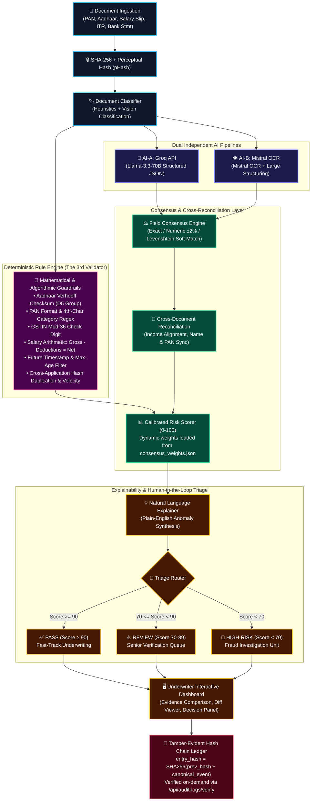

<div align="center">


<br/><br/>


# 🛡️ D U A L T R U S T &nbsp; A I
### *Fraud-Resilient Loan Document Intelligence & Explainable Verification Engine*

<p align="center">
  <a href="https://github.com/rajrishabh23959-oss/DualTrust-AI">
    
  </a>
</p>

<p align="center">
  <b>Eliminating single-model hallucinations, catching manipulated documents with math, and empowering human underwriters.</b>
</p>

<!-- Social-Style & Technical Badges -->
<p align="center">
  <a href="https://github.com/rajrishabh23959-oss/DualTrust-AI/stargazers"></a>
  <a href="https://github.com/rajrishabh23959-oss/DualTrust-AI/network/members"></a>
  <a href="https://github.com/rajrishabh23959-oss/DualTrust-AI/issues"></a>
  <a href="https://github.com/rajrishabh23959-oss/DualTrust-AI/blob/main/LICENSE"></a>
  <br/>
  <a href="https://www.rbi.org.in/"></a>
  <a href="https://www.meity.gov.in/"></a>
  <a href="https://fastapi.tiangolo.com/"></a>
  <a href="https://react.dev/"></a>
  <a href="https://groq.com/"></a>
  <a href="https://mistral.ai/"></a>
</p>

<!-- skillicons.dev stack row -->
<p align="center">
  <a href="#-tech-stack">
    
  </a>
</p>

<p align="center">
  <a href="#-quick-start"><b>⚡ Quick Start</b></a> •
  <a href="#-the-problem--the-dualtrust-solution"><b>💡 Problem → Solution</b></a> •
  <a href="#-why-dualtrust-single-ai-vs-dualtrust"><b>⚖️ Why DualTrust?</b></a> •
  <a href="#-system-architecture"><b>🏗️ Architecture</b></a> •
  <a href="#-interactive-demo-scenarios"><b>🎯 Demo Scenarios</b></a> •
  <a href="#-deterministic-rule-engine--consensus"><b>📐 Rules & Consensus</b></a> •
  <a href="#-api-documentation"><b>📡 API Docs</b></a> •
  <a href="#-test-suite"><b>🧪 Tests</b></a>
</p>


</div>

<br/>

> [!IMPORTANT]
> ### ⚠️ Mandatory Compliance Policy: The “Never Auto-Approves” Principle
> **DualTrust AI is engineered strictly as an intelligent routing, evidence synthesis, and risk detection copilot for human underwriters.**
> 
> * 🚫 **Zero Automated Sanctions:** The system **never** approves or rejects loan applications autonomously.
> * 👤 **Human-in-the-Loop (HITL) Core:** All applications are scored and triaged into `PASS`, `REVIEW`, or `HIGH_RISK_REVIEW` to steer credit officers directly to anomalies and discrepancies.
> * 🏛️ **Regulatory Mandate:** Fully aligns with the **RBI Digital Lending Guidelines (2022)** (which prohibit black-box automated lending decisions without human oversight) and the **DPDP Act (2023)**.

---

## 💡 The Problem → The DualTrust Solution

```
┌────────────────────────────────────────────────────────────────────────────────────────┐
│                                 THE FINTECH DILEMMA                                    │
├────────────────────────────────────────────────────┬───────────────────────────────────┤
│ ❌ The Traditional / Single-AI Trap                │ 🛡️ The DualTrust AI Breakthrough  │
├────────────────────────────────────────────────────┼───────────────────────────────────┤
│ • Single-model visual LLMs hallucinate numbers     │ • Dual independent AI engines    │
│   and fail on blurred or complex bank tables.      │   (Groq & Mistral) cross-verify.  │
│                                                    │                                   │
│ • Amateur Photoshop edits easily deceive vision    │ • Deterministic mathematical      │
│   models without triggering error flags.           │   checks (Verhoeff, Mod-36).      │
│                                                    │                                   │
│ • Income on payslips is treated in isolation from  │ • Cross-document reconciliation   │
│   actual bank credits and filed ITRs.              │   across multiple instruments.    │
│                                                    │                                   │
│ • Database audit logs are mutable and easily       │ • Cryptographic SHA-256 hash      │
│   tampered with during regulatory audits.          │   chains guarantee immutability.  │
│                                                    │                                   │
│ • Black-box auto-approval violates RBI compliance  │ • Explainable HITL triage routing │
│   and leads to catastrophic bad loan write-offs.   │   empowers human underwriters.    │
└────────────────────────────────────────────────────┴───────────────────────────────────┘
```

DualTrust AI bridges the high-risk gap in loan underwriting. By pairing **Groq** (`llama-3.3-70b-versatile`) with **Mistral OCR** (`mistral-ocr-latest` + `mistral-large-latest`), discrepancies between models are treated as **signals of ambiguity**, not fatal crashes. When coupled with an air-gapped **deterministic rule engine** ("The Third Validator"), manipulated documents are caught regardless of model biases.

---

## ⚖️ Why DualTrust? (Single AI vs. DualTrust)

| Underwriting Vector | ❌ Conventional Single-AI Pipeline | 🛡️ DualTrust AI Defense Matrix |
| :--- | :--- | :--- |
| **Model Redundancy** | Single point of failure; model hallucinations go undetected. | **Dual Independent AI Pipelines:** Groq & Mistral independently extract structured JSON to establish consensus. |
| **Adversarial Resilience** | Fooled by visual text replacement and font matching. | **Algorithmic Third Validator:** Mathematical Verhoeff and Mod-36 checksums catch forged IDs without relying on vision models. |
| **Cross-Instrument Check** | Evaluates salary slips, ITRs, and bank statements as isolated silos. | **Multi-Document Reconciliation:** Automatically flags salary vs. bank average monthly credit divergences (e.g. >25%). |
| **Scoring Governance** | Hardcoded, opaque confidence percentages. | **Tunable Consensus Matrix:** Transparent weights in [`consensus_weights.json`](./consensus_weights.json) without code rebuilds. |
| **Audit Integrity** | Standard SQL rows easily modified or deleted. | **Cryptographic Hash Chain:** Merkle-inspired SHA-256 link (`entry_hash = SHA256(prev_hash + canonical_event)`). |
| **Regulatory Standing** | High risk of violating RBI automated lending rules. | **Strict HITL Architecture:** Triage routing only; final decisions remain 100% human-governed. |

---

## 🖼️ User Experience & Underwriter Dashboard

<div align="center">

```
┌────────────────────────────────────────────────────────────────────────────────────────────────────────┐
│  🛡️ DualTrust AI  |  Application: APP-2024-8901 (Rohit Verma)  |  Status: 🔴 HIGH RISK REVIEW (38/100)  │
├────────────────────────────────────────────────────────────────────────────────────────────────────────┤
│  [Summary]   [Field Comparison]   [Rule Engine (4/6)]   [Cross-Doc Checks (2/4)]   [Audit Chain (✓)]   │
├────────────────────────────────────────────────────────────────────────────────────────────────────────┤
│  ⚡ AI-A (Groq Llama-3.3)         ⚡ AI-B (Mistral OCR)            ⚖️ Consensus & Discrepancy           │
│  ├─ Name: Rohit Verma             ├─ Name: Rohit Verma            ├─ Match Status: EXACT (1.00)        │
│  ├─ PAN: ABCPV1234P               ├─ PAN: ABCPV1234P              ├─ Match Status: EXACT (1.00)        │
│  ├─ Net Salary: ₹1,80,000         ├─ Net Salary: ₹1,80,000        ├─ Match Status: NUMERIC (1.00)      │
│  └─ Aadhaar: 1234 5678 9013       └─ Aadhaar: 1234 5678 9013      └─ Rule Check: 🔴 VERHOEFF FAIL      │
├────────────────────────────────────────────────────────────────────────────────────────────────────────┤
│  💡 EXPLAINABILITY DIAGNOSTIC                                                                          │
│  • Aadhaar number fails Verhoeff check digit validation (probable synthetic identity).                │
│  • Net salary (₹1,80,000/mo) diverges by 76.6% from bank average monthly credits (₹42,000/mo).         │
│  • Salary slip issuance date is in the FUTURE.                                                         │
├────────────────────────────────────────────────────────────────────────────────────────────────────────┤
│  👤 UNDERWRITER DECISION PANEL:   [ ✅ Approve Loan ]   [ ⚠️ Request Documents ]   [ 🚫 Reject Loan ]  │
└────────────────────────────────────────────────────────────────────────────────────────────────────────┘
```
*Interactive React + TypeScript Underwriter Dashboard featuring real-time consensus diffs, rule breakdowns, and one-click audit chain verification.*

</div>

---

## 🏗️ System Architecture

DualTrust AI operates on a multi-tiered pipeline ensuring zero unverified assumptions:



---

## 🎯 Interactive Demo Scenarios

The system includes 3 pre-seeded scenarios illustrating distinct fraud and ambiguity patterns:

<div align="center">

| Scenario | Applicant | Category & Amount | Risk Score | Routing Outcome | Core Verification Mechanics |
| :---: | :--- | :--- | :---: | :---: | :--- |
| **1** | **Priya Kapoor** | Personal Loan<br/>`₹1,200,000` | **`94 / 100`** | <kbd style="background:#166534;color:#dcfce7;padding:4px 8px;border-radius:4px;font-weight:bold;">✅ PASS</kbd> | • 100% agreement between Groq & Mistral.<br/>• Verhoeff checksum & PAN category valid.<br/>• Salary aligns with bank credits (1.2% delta). |
| **2** | **Arjun Mehta** | Vehicle Loan<br/>`₹750,000` | **`76 / 100`** | <kbd style="background:#854d0e;color:#fef9c3;padding:4px 8px;border-radius:4px;font-weight:bold;">⚠️ REVIEW</kbd> | • Employer name formatting soft-mismatch.<br/>• Levenshtein similarity = 0.88 (>0.80 threshold).<br/>• Zero fraud markers; flagged for human confirmation. |
| **3** | **Rohit Verma** | Business Loan<br/>`₹2,500,000` | **`38 / 100`** | <kbd style="background:#991b1b;color:#fee2e2;padding:4px 8px;border-radius:4px;font-weight:bold;">🔴 HIGH RISK</kbd> | • 🔴 Aadhaar fails Verhoeff check digit test.<br/>• 🔴 Payslip issuance timestamp is in the FUTURE.<br/>• 🔴 76.6% discrepancy: salary vs bank monthly credits. |

</div>

---

## ⚡ Quick Start

Deploy DualTrust AI locally in under two minutes using either Docker Compose or the standalone native launcher.

### Prerequisites
* **Git** installed
* **Groq API Key** ([console.groq.com](https://console.groq.com/))
* **Mistral API Key** ([console.mistral.ai](https://console.mistral.ai/))
* **Docker & Docker Compose** *(for Containerized Mode)* **OR** **Python 3.11+ & Node.js 18+** *(for Local Mode)*

---

### Option 1: Docker Compose (Production-Ready)

```bash
# 1. Clone the repository
git clone https://github.com/rajrishabh23959-oss/DualTrust-AI.git
cd dualtrust-ai

# 2. Configure environment variables
make setup
# Or manually: copy .env.example .env (Windows) or cp .env.example .env (Linux/macOS)

# 3. Insert your Groq and Mistral API keys in .env
# GROQ_API_KEY=gsk_...
# MISTRAL_API_KEY=...

# 4. Start all containers (Postgres, Redis, Backend, Worker, Frontend)
make dev

# 5. In a second terminal, seed the 3 demo applications
make seed
```

---

### Option 2: 1-Click Native Local Runner (Zero Container Overhead)

DualTrust AI includes automated native runners that set up a local SQLite database, seed the demo records, and start both servers simultaneously:

#### Windows:
```cmd
copy .env.example .env
notepad .env
run_local.bat
```
*(Or execute: `python run_local.py`)*

#### macOS / Linux:
```bash
cp .env.example .env
nano .env

# Set up Python backend
cd backend
python3 -m venv venv && source venv/bin/activate
pip install -r requirements.txt
python -m app.utils.seed_data
uvicorn app.main:app --host 127.0.0.1 --port 8000 --reload &

# Set up React frontend
cd ../frontend
npm install
npm run dev
```

---

### 🌐 Default Access Endpoints & Credentials

```
┌──────────────────────────────────────┬─────────────────────────────┬───────────────────────────┐
│ Service                              │ URL                         │ Credentials / Notes       │
├──────────────────────────────────────┼─────────────────────────────┼───────────────────────────┤
│ 🖥️ Underwriter Web Dashboard         │ http://localhost:3000       │ demo@dualtrust.ai         │
│                                      │ (or :5173 for native Vite)  │ Password: demo1234        │
│ 📖 FastAPI Swagger Documentation     │ http://localhost:8000/docs  │ Interactive REST Explorer │
│ 📚 ReDoc Schema Specification        │ http://localhost:8000/redoc │ Formatted API Specs       │
│ 🩺 Backend Health Check Endpoint     │ http://localhost:8000/health│ {"status": "ok"}          │
└──────────────────────────────────────┴─────────────────────────────┴───────────────────────────┘
```

---

## 📐 Deterministic Rule Engine & Consensus

<details open>
<summary><b>📐 Algorithmic Rule Engine ("The Third Validator") — Click to view rule specifications</b></summary>
<br/>

The deterministic rule engine executes pure mathematics and regular expressions without sending document data to any language model:

```
┌───────────────────┬──────────────────────────────────────────────────────────────┬───────────────┐
│ Rule Identifier   │ Algorithm / Verification Mechanics                           │ Penalty Level │
├───────────────────┼──────────────────────────────────────────────────────────────┼───────────────┤
│ AADHAAR_CHECKSUM  │ Verhoeff algorithm using Dihedral Group D5 multiplication    │ HIGH_RISK     │
│                   │ and permutation tables across all 12 digits.                 │ (-40 pts)     │
│                   │                                                              │               │
│ PAN_FORMAT        │ Regex ^[A-Z]{5}[0-9]{4}[A-Z]$ + 4th character validation    │ HIGH_RISK     │
│                   │ against valid tax category codes (P, C, H, A, B, F, T, L...).│ (-40 pts)     │
│                   │                                                              │               │
│ GSTIN_CHECKSUM    │ Mod-36 check digit algorithm matching 15th character.        │ HIGH_RISK     │
│                   │                                                              │ (-40 pts)     │
│                   │                                                              │               │
│ SALARY_ARITHMETIC │ Validates that |Gross - Deductions - Net| <= 2% * Gross.     │ REVIEW        │
│                   │ Catches fabricated payslips with inconsistent math.          │ (-15 pts)     │
│                   │                                                              │               │
│ DATE_FUTURE       │ Confirms all document issuance timestamps <= current date.   │ HIGH_RISK     │
│                   │                                                              │ (-40 pts)     │
│                   │                                                              │               │
│ SALARY_AGE        │ Verifies salary slips were issued within the last 90 days.   │ REVIEW        │
│                   │                                                              │ (-15 pts)     │
│                   │                                                              │               │
│ DUPLICATE_HASH    │ SHA-256 binary match checking across all historical files.   │ HIGH_RISK     │
│                   │                                                              │ (-40 pts)     │
│                   │                                                              │               │
│ VELOCITY_PAN      │ Flags if the same PAN number appears in >2 applications     │ HIGH_RISK     │
│                   │ within a rolling 30-day window.                              │ (-40 pts)     │
└───────────────────┴──────────────────────────────────────────────────────────────┴───────────────┘
```

</details>

<br/>

<details>
<summary><b>⚙️ Consensus Matrix Configuration (consensus_weights.json) — Click to view formula & JSON</b></summary>
<br/>

All risk weights and thresholds are dynamically loaded from [`./consensus_weights.json`](./consensus_weights.json):

```json
{
  "weights": {
    "agreement_score": 0.40,
    "cross_document_consistency": 0.30,
    "tamper_and_rule_signals": 0.20,
    "ocr_model_confidence": 0.10
  },
  "thresholds": {
    "pass": 90,
    "review": 70
  },
  "field_match_tolerance": {
    "numeric_percent": 2.0,
    "date_days": 0,
    "string_levenshtein_soft_threshold": 0.80
  },
  "rule_severity_penalties": {
    "HIGH_RISK": 40,
    "REVIEW": 15
  },
  "single_source_score_cap": 65
}
```

$$\text{Overall Score} = 0.40(S_{\text{agreement}}) + 0.30(S_{\text{cross\_doc}}) + 0.20(S_{\text{tamper\_rule}}) + 0.10(S_{\text{confidence}})$$

> **Single Source Protection:** If one AI pipeline is unavailable (e.g. API downtime or quota limit), the maximum possible score is capped at **65**, guaranteeing human underwriter intervention.

</details>

---

## 🔗 Cryptographic Hash-Chained Audit Trail

Every state change, document upload, AI analysis, and reviewer action is cryptographically chained to guarantee non-repudiation:

$$\text{Hash}_n = \text{SHA-256}\Big(\text{Hash}_{n-1} \;\|\; \text{CanonicalJSON}(\text{actor}, \text{action}, \text{entity}, \text{metadata}, \text{timestamp})\Big)$$

```
┌────────────────────────┐      ┌────────────────────────┐      ┌────────────────────────┐
│     Genesis Block      │ ───> │   Entry 1: Doc Upload  │ ───> │   Entry 2: Consensus   │
│ Hash: DUALTRUST_0000...│      │ Prev: DUALTRUST_0000...│      │ Prev: 7f83b12a...      │
│                        │      │ Hash: 7f83b12a...      │      │ Hash: 4a2b91c0...      │
└────────────────────────┘      └────────────────────────┘      └────────────────────────┘
```

* **Live Verification:** Underwriters can trigger a full-chain audit by clicking **"Verify Hash Chain"** on the dashboard or calling `GET /api/audit-logs/verify`.
* **Tamper-Evident:** Direct row modifications or deletions in the SQL database immediately break the hash sequence, pinpointing the corrupted entry ID for internal compliance officers.

---

## 📡 API Documentation

<details open>
<summary><b>📚 Core REST Endpoints Reference — Click to expand</b></summary>
<br/>

| HTTP Method | Path | Description | Access |
| :--- | :--- | :--- | :--- |
| `POST` | `/api/applications` | Create a new loan application container. | Public / Auth |
| `GET` | `/api/applications` | List applications (filter by status: `PASS`, `REVIEW`, etc.). | Auth |
| `GET` | `/api/applications/{id}` | Fetch application details, overall score, and triage state. | Auth |
| `POST` | `/api/applications/{id}/documents` | Upload a document (multipart/form-data with auto-classification). | Auth |
| `POST` | `/api/documents/{id}/analyze` | Trigger asynchronous/synchronous dual-AI extraction & rules. | Auth |
| `GET` | `/api/applications/{id}/risk-score` | Retrieve calibrated consensus score and sub-scores. | Auth |
| `GET` | `/api/applications/{id}/consensus` | Retrieve field-by-field Groq vs. Mistral comparison matrix. | Auth |
| `GET` | `/api/applications/{id}/rule-checks`| Fetch deterministic rule check outputs. | Auth |
| `GET` | `/api/applications/{id}/cross-doc-checks` | Fetch cross-document identity and income reconciliation records. | Auth |
| `POST` | `/api/applications/{id}/review` | Submit human underwriter decision (`APPROVE`, `REJECT`, `REQUEST_MORE`). | Underwriter |
| `GET` | `/api/audit-logs/verify` | Validate cryptographic integrity of the SHA-256 hash chain. | Auditor |
| `POST` | `/api/verify` | **B2B API:** Single-call stateless document verification (Base64). | API Key |

</details>

<br/>

<details>
<summary><b>🧪 Sample Request & Response Payloads — Click to expand</b></summary>
<br/>

#### 1. Create Loan Application (`POST /api/applications`)
```bash
curl -X POST http://localhost:8000/api/applications \
  -H "Content-Type: application/json" \
  -d '{
    "applicant_name": "Priya Kapoor",
    "loan_type": "personal",
    "loan_amount": 1200000.00
  }'
```

```json
{
  "id": "e4f8b91c-1a2b-4c3d-8e5f-0a1b2c3d4e5f",
  "applicant_name": "Priya Kapoor",
  "loan_type": "personal",
  "loan_amount": 1200000.0,
  "status": "DRAFT",
  "created_at": "2026-10-12T22:30:00Z"
}
```

#### 2. Verify Audit Chain (`GET /api/audit-logs/verify`)
```bash
curl http://localhost:8000/api/audit-logs/verify
```

```json
{
  "chain_valid": true,
  "total_entries": 42,
  "broken_entries": []
}
```

</details>

---

## 🧪 Test Suite

DualTrust AI includes automated unit and integration tests covering the deterministic rule engine, consensus engine, and cross-document verification:

```bash
# Execute test suite via Docker
make test

# Or execute locally with pytest
cd backend
pytest tests/ -v
```

```
backend/tests/test_rule_engine.py::TestPANFormat::test_valid_pan_individual PASSED
backend/tests/test_rule_engine.py::TestPANFormat::test_invalid_pan_bad_category PASSED
backend/tests/test_rule_engine.py::TestAadhaarChecksum::test_valid_aadhaar PASSED
backend/tests/test_rule_engine.py::TestAadhaarChecksum::test_invalid_aadhaar_from_scenario_3 PASSED
backend/tests/test_rule_engine.py::TestGSTINChecksum::test_valid_gstin PASSED
backend/tests/test_consensus.py::TestFieldMatching::test_levenshtein_soft_match PASSED
backend/tests/test_cross_doc.py::TestIncomeReconciliation::test_salary_vs_bank_gap PASSED
```

---

## 🗺️ Roadmap

- [x] **Dual AI Pipeline Extraction** (Groq Llama 3.3 70B + Mistral OCR)
- [x] **Deterministic Mathematical Engine** (Verhoeff $D_5$, Mod-36, Regex, Salary Arithmetic)
- [x] **Cross-Document Identity & Income Reconciliation**
- [x] **Cryptographic SHA-256 Hash-Chained Audit Trail**
- [x] **Natural Language Anomaly Explainer**
- [x] **Human Underwriter Dashboard & Review Decision Panel**
- [ ] **Phase 2: IndiaStack & External Integrations**
  - [ ] Direct DigiLocker consent-based XML/PDF retrieval
  - [ ] Sahamati Account Aggregator (AA) framework adapter
  - [ ] Real-time NSDL PAN and GSTN API verification webhooks
- [ ] **Phase 3: Security & Post-Quantum Governance**
  - [ ] Zero-Knowledge Proof (ZKP) identity verification for PII redaction
  - [ ] Post-quantum cryptographic hash chaining
  - [ ] Underwriter review SLA & decision audit metrics

---

## 🤝 Contributing

We welcome contributions from the open-source fintech, cybersecurity, and AI communities!

1. **Fork the Repository:** Click "Fork" at the top right of this repository.
2. **Create a Feature Branch:**
   ```bash
   git checkout -b feature/offline-aadhaar-qr-decoder
   ```
3. **Commit Your Changes:**
   ```bash
   git commit -m "feat: add secure offline Aadhaar secure QR code parser"
   ```
4. **Run the Test Suite:**
   ```bash
   pytest backend/tests/
   ```
5. **Open a Pull Request:** Submit your PR against `main` with a clear explanation of changes.

---

## 📜 License

This project is licensed under the **MIT License** — see the [LICENSE](LICENSE) file for details.

---

<div align="center">


<br/>

### ⭐ Support DualTrust AI

If you find DualTrust AI helpful for fintech, fraud prevention, or AI alignment, please consider giving us a **Star** on GitHub!

<p align="center">
  <a href="https://github.com/rajrishabh23959-oss/DualTrust-AI">
    
  </a>
</p>

<sub>Built with precision by <b>Team Destroyers X</b> for fraud-resilient, transparent financial underwriting.</sub>  
<sub><i>DualTrust AI — Disagreement is a signal, not a verdict.</i></sub>

<br/>


</div>
